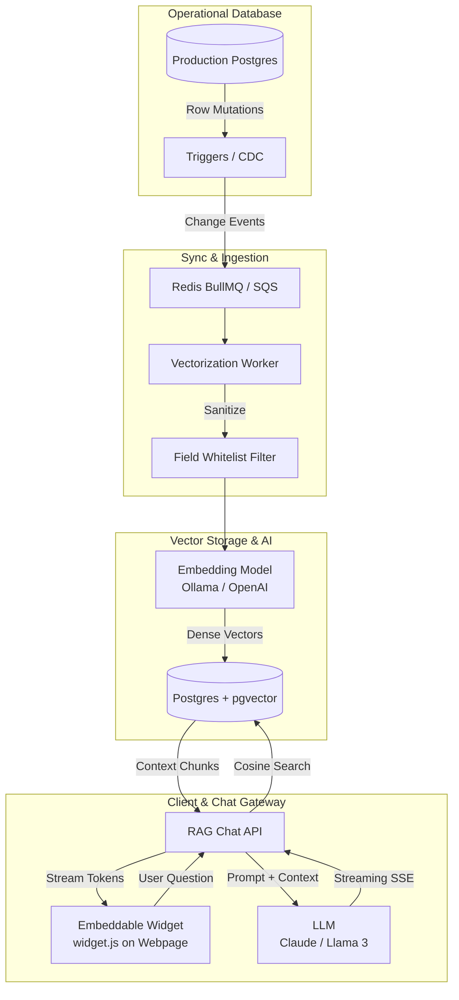

# DB-Native RAG Chatbot Widget

> **Privacy-first, real-time RAG widget that syncs directly from live production databases via CDC/triggers.**

---

## 📖 Project Overview

An embeddable RAG (Retrieval-Augmented Generation) chatbot widget that any website can install. Instead of crawling URLs or requiring document uploads, it connects directly to the site's operational SQL and NoSQL databases. Only whitelisted fields are vectorized, and updates to the source data automatically trigger re-vectorization via DB triggers/CDC streams—keeping the bot's knowledge live, accurate, and secure.

---

## 📚 System Modules Documentation

Full architectural and technical module specifications are available in the [`docs/`](./docs/) directory:

| Module | Documentation File | Core Responsibility |
| :--- | :--- | :--- |
| **Overview** | [`docs/00-rag-architecture-overview.md`](./docs/00-rag-architecture-overview.md) | High-level system architecture, data flow diagrams, boundaries, and guarantees. |
| **Module 01** | [`docs/01-ingestion-cdc-module.md`](./docs/01-ingestion-cdc-module.md) | Database-native triggers (`pg_notify`), logical replication, event envelope schemas, and queue buffering. |
| **Module 02** | [`docs/02-privacy-whitelist-module.md`](./docs/02-privacy-whitelist-module.md) | Field-level whitelisting, default-deny privacy rules, PII auto-guard, and document templating. |
| **Module 03** | [`docs/03-vectorization-pipeline-module.md`](./docs/03-vectorization-pipeline-module.md) | Queue workers (Redis/BullMQ), embedding models (Ollama/OpenAI), `pgvector` HNSW indexes, content hashing, and upsert/delete operations. |
| **Module 04** | [`docs/04-rag-query-retrieval-module.md`](./docs/04-rag-query-retrieval-module.md) | Cosine similarity search (`<=>`), context stuffing, anti-hallucination guardrails, and SSE streaming. |
| **Module 05** | [`docs/05-embeddable-widget-module.md`](./docs/05-embeddable-widget-module.md) | Zero-dependency `<script>` tag widget, Shadow DOM styling isolation, SSE parser, and CORS security. |
| **Original Spec**| [`docs/idea-document.md`](./docs/idea-document.md) | Original idea document, problem statement, market landscape, and MVP scope. |

---

## 🏛️ System Architecture Diagram

