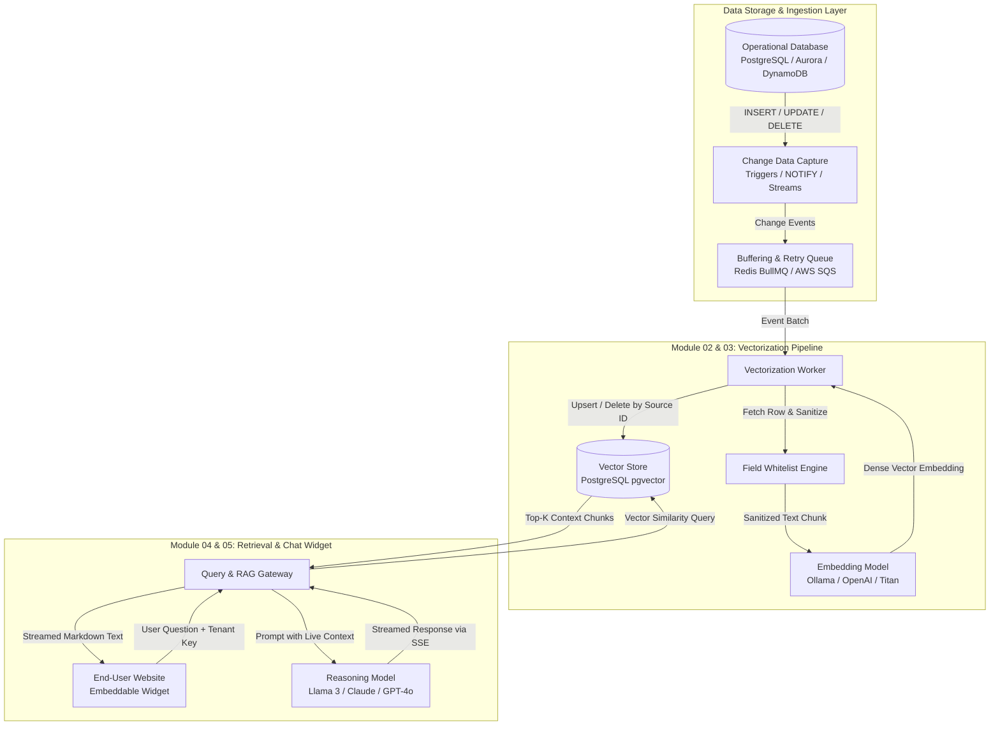

# Module 00: DB-Native RAG System Architecture Overview

## 1. Executive Summary & Vision

The **DB-Native RAG Chatbot Widget** is an enterprise-grade Retrieval-Augmented Generation system designed to connect directly to operational SQL and NoSQL production databases. 

Unlike traditional RAG systems that rely on crawling public web pages or manual document uploads, this system:
1. **Listens directly to database change streams (CDC / Triggers)** to keep vector embeddings continuously up to date with zero manual intervention.
2. **Enforces strict, field-level whitelisting** before any data touches the embedding pipeline, providing provable data privacy and eliminating the risk of leaking internal or sensitive columns.
3. **Serves an embeddable, low-latency chat widget** capable of answering end-user queries using live, verified operational data.

---

## 2. High-Level Architecture Diagram

---

## 3. System Modules Breakdown

| Module | File | Core Responsibility |
| :--- | :--- | :--- |
| **Module 01: Ingestion & CDC** | [`01-ingestion-cdc-module.md`](./01-ingestion-cdc-module.md) | Captures DB change events (INSERT, UPDATE, DELETE) using database-native mechanisms and queues them reliably. |
| **Module 02: Privacy & Whitelisting** | [`02-privacy-whitelist-module.md`](./02-privacy-whitelist-module.md) | Enforces strict field whitelists, scrubs sensitive/private columns, and structures data into embeddable document formats. |
| **Module 03: Vectorization Pipeline** | [`03-vectorization-pipeline-module.md`](./03-vectorization-pipeline-module.md) | Generates embeddings, manages worker concurrency/backoff, and performs deterministic upserts/deletions in `pgvector`. |
| **Module 04: Query & RAG Retrieval** | [`04-rag-query-retrieval-module.md`](./04-rag-query-retrieval-module.md) | Performs cosine similarity search, constructs grounded system prompts, and orchestrates streaming LLM answers. |
| **Module 05: Embeddable Widget** | [`05-embeddable-widget-module.md`](./05-embeddable-widget-module.md) | Lightweight `<script>` tag widget providing floating chat UI, SSE streaming display, and tenant isolation. |

---

## 4. Key Architectural Guarantees

1. **Zero Data Staleness:** Vector updates occur asynchronously in near-real-time (typically < 500ms after database commit).
2. **Zero Sensitive Data Ingestion:** Fields not present on the whitelist are discarded in memory before serialization or transmission to any embedding model.
3. **Idempotency & Deduplication:** Vector upserts are keyed by `(tenant_id, source_table, source_id)`. Modifying a record updates its existing vector in place rather than polluting the vector space with duplicates.
4. **Tenant Isolation:** All vector queries and change events are strictly partitioned by `tenant_id` at the database index level.
