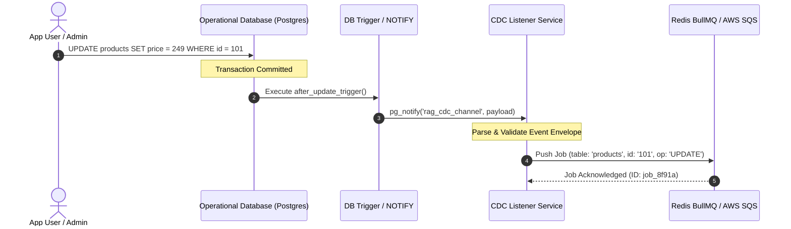

# Module 01: Ingestion & Change Data Capture (CDC) Module

## 1. Module Overview & Purpose

The **Ingestion & CDC Module** acts as the sensory nervous system of the RAG platform. Its primary role is to detect changes in customer databases (inserts, updates, deletes) in real-time and translate those database operations into structured event messages that enter the processing queue.

### Core Objectives:
- Eliminate manual document re-indexing or scheduled batch jobs.
- Intercept mutations directly at the database layer with sub-second latency.
- Provide reliable buffering against spike traffic (e.g., bulk product catalog updates).

---

## 2. Ingestion Mechanism Architecture



---

## 3. Supported Capture Modes

### Mode A: Database-Native Triggers + `LISTEN/NOTIFY` (Recommended for MVP / Local)
- **Mechanism:** PostgreSQL `AFTER INSERT OR UPDATE OR DELETE` triggers emit JSON payloads via `pg_notify()`.
- **Latency:** Instantaneous (< 5ms).
- **Pros:** Zero external infrastructure required; runs inside standard PostgreSQL.
- **SQL Implementation Example:**
  ```sql
  CREATE OR REPLACE FUNCTION notify_rag_mutation()
  RETURNS TRIGGER AS $$
  DECLARE
    record_id TEXT;
    payload JSON;
  BEGIN
    IF (TG_OP = 'DELETE') THEN
      record_id := OLD.id::TEXT;
    ELSE
      record_id := NEW.id::TEXT;
    END IF;

    payload := json_build_object(
      'tenantId', current_setting('app.current_tenant', true),
      'table', TG_TABLE_NAME,
      'operation', TG_OP,
      'recordId', record_id,
      'timestamp', clock_timestamp()
    );

    PERFORM pg_notify('rag_cdc_channel', payload::text);
    RETURN NULL;
  END;
  $$ LANGUAGE plpgsql;
  ```

### Mode B: Logical Replication / Debezium (Enterprise Scale)
- **Mechanism:** Reads PostgreSQL write-ahead log (WAL) or DynamoDB Streams.
- **Pros:** Decouples entirely from database write transactions.
- **Cons:** Requires replication slots and dedicated streaming connector infrastructure.

---

## 4. Change Event Payload Specification

Every change event emitted to the queue adheres to this schema:

```typescript
export interface CdcChangeEvent {
  /** Unique ID of the tenant / customer */
  tenantId: string;

  /** Name of the database table or collection */
  table: string;

  /** Mutation type */
  operation: 'INSERT' | 'UPDATE' | 'DELETE';

  /** Primary key identifier of the mutated record */
  recordId: string;

  /** ISO 8601 UTC timestamp of mutation */
  timestamp: string;

  /** Retry attempt counter */
  retryCount?: number;
}
```

---

## 5. Buffering & Rate Limiting (Queue Layer)

To protect downstream LLM and embedding APIs from being overwhelmed during bulk import operations:
1. **Debouncing:** Rapid successive updates to the same `recordId` within a 500ms window are collapsed into a single job.
2. **Backoff & Retries:** Failed queue jobs retry with exponential backoff:
   - Initial delay: 1000ms
   - Max retries: 5 attempts
   - Dead Letter Queue (DLQ): Poison messages are diverted to DLQ for administrator inspection.
3. **Queue Healthcheck:** The CDC listener monitors queue backlog depth and raises alerts if queue latency exceeds 10 seconds.
