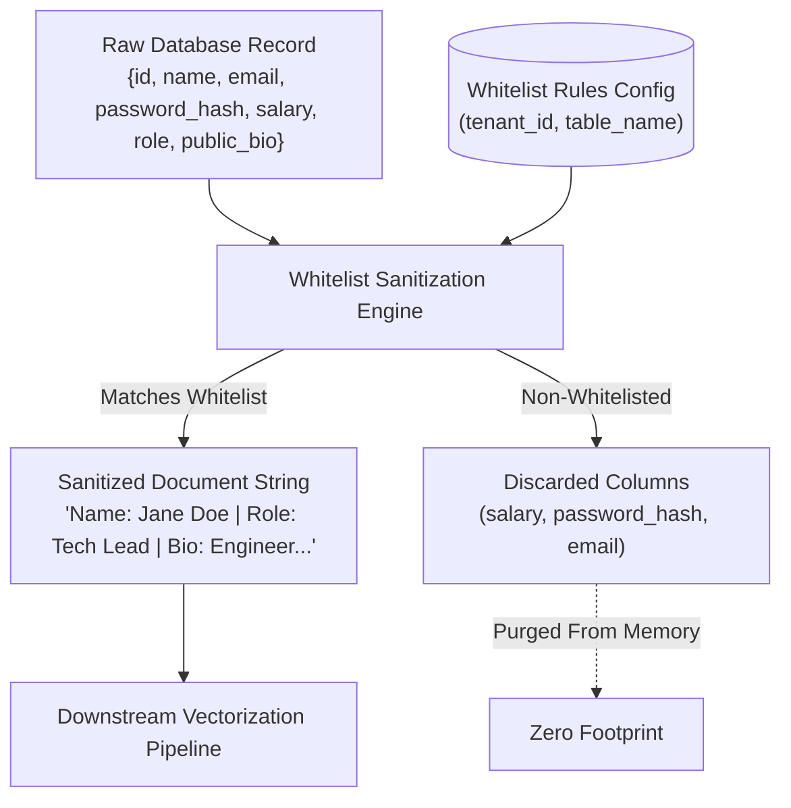

# Module 02: Privacy & Field Whitelisting Engine Module

## 1. Module Overview & Purpose

The **Privacy & Field Whitelisting Engine** is the core compliance and security differentiator of the platform. It guarantees that **private, internal, or sensitive database columns never enter the AI embedding pipeline or LLM context under any circumstances**.

### Key Value Proposition:
- Traditional RAG crawlers ingest full web pages or documents containing confidential headers, draft flags, or developer notes.
- This engine strictly filters raw database rows through a cryptographically checked configuration table before serialization.

---

## 2. Sanitization Pipeline Architecture



---

## 3. Whitelist Configuration Schema

The tenant administrator configures which fields can be made publicly searchable by the RAG widget:

```json
{
  "tenantId": "tenant_enterprise_402",
  "table": "products",
  "whitelistedFields": [
    "name",
    "description",
    "category",
    "retail_price",
    "stock_status",
    "specifications"
  ],
  "excludedFields": [
    "supplier_cost",
    "profit_margin",
    "internal_notes",
    "wholesale_vendor_id"
  ],
  "documentTemplate": "Product: {{name}} | Category: {{category}} | Price: ${{retail_price}} | Status: {{stock_status}}\nDetails: {{description}}\nSpecs: {{specifications}}"
}
```

### Whitelist Invariants:
1. **Default-Deny:** If a column exists on a database table but is not explicitly declared in `whitelistedFields`, it is strictly omitted.
2. **Template Validation:** The `documentTemplate` cannot reference fields absent from `whitelistedFields`. Any template violation raises an error at save time.
3. **PII Auto-Guard:** Regular expression scanners automatically flag common PII field names (`ssn`, `password`, `secret`, `credit_card`) and prevent accidental addition to whitelists.

---

## 4. Document Assembly Engine

When a record is sanitized, the engine formats it into a high-density, semantic text representation optimized for vector retrieval:

```typescript
export class WhitelistSanitizationService {
  sanitizeAndFormat(
    rawRecord: Record<string, any>,
    config: WhitelistConfig,
  ): string {
    const sanitized: Record<string, any> = {};

    for (const field of config.whitelistedFields) {
      if (rawRecord[field] !== undefined && rawRecord[field] !== null) {
        sanitized[field] = rawRecord[field];
      }
    }

    if (config.documentTemplate) {
      return this.renderTemplate(config.documentTemplate, sanitized);
    }

    // Default key-value serialization
    return Object.entries(sanitized)
      .map(([key, value]) => `${this.formatKey(key)}: ${value}`)
      .join('\n');
  }

  private formatKey(key: string): string {
    return key.replace(/_/g, ' ').replace(/\b\w/g, (c) => c.toUpperCase());
  }
}
```

---

## 5. Security & Verification Contract

- **Zero Persistence of Excluded Data:** Excluded fields are filtered out in memory during pipeline execution; they are never written to disk, cache, or vector metadata.
- **Audit Logging:** Every sanitization run produces a cryptographically signed hash of the fields included vs. excluded for compliance audits (SOC 2 / ISO 27001).
