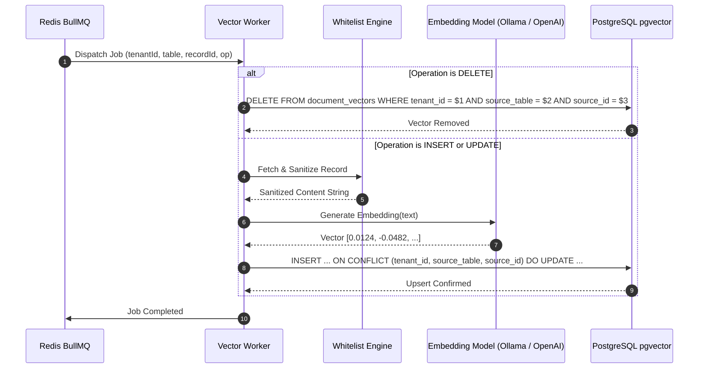

# Module 03: Vectorization & Embedding Pipeline Module

## 1. Module Overview & Purpose

The **Vectorization & Embedding Pipeline Module** ingests sanitized text documents from the queue, generates high-dimensional mathematical vector representations (embeddings), and deterministically manages their lifecycle in a `pgvector` store.

### Core Objectives:
- Asynchronous batch processing of change events.
- Deterministic upsert semantics (replacing vectors instead of creating duplicates).
- Complete cleanup of vector data when source records are deleted.

---

## 2. Processing Lifecycle Diagram



---

## 3. Database Vector Store Schema (`pgvector`)

The underlying storage utilizes PostgreSQL with the `pgvector` extension:

```sql
-- Enable vector extension
CREATE EXTENSION IF NOT EXISTS vector;

-- Vector Chunks Table
CREATE TABLE document_vectors (
  id UUID PRIMARY KEY DEFAULT gen_random_uuid(),
  tenant_id VARCHAR(64) NOT NULL,
  source_table VARCHAR(64) NOT NULL,
  source_id VARCHAR(128) NOT NULL,
  content TEXT NOT NULL,
  content_hash VARCHAR(64) NOT NULL,
  metadata JSONB DEFAULT '{}'::jsonb,
  embedding vector(1536), -- 1536 for OpenAI/Titan or 768 for Ollama nomic-embed-text
  created_at TIMESTAMP WITH TIME ZONE DEFAULT NOW(),
  updated_at TIMESTAMP WITH TIME ZONE DEFAULT NOW(),

  -- Deterministic single-record constraint
  CONSTRAINT uq_tenant_source_record UNIQUE (tenant_id, source_table, source_id)
);

-- HNSW Vector Index for High-Speed Similarity Search
CREATE INDEX idx_document_vectors_embedding_hnsw 
ON document_vectors 
USING hnsw (embedding vector_cosine_ops)
WITH (m = 16, ef_construction = 64);

-- Tenant Isolation Composite Index
CREATE INDEX idx_document_vectors_tenant_lookup
ON document_vectors (tenant_id, source_table);
```

---

## 4. Embedding Provider Abstraction

The system implements a pluggable provider interface supporting both zero-cost local inference and production cloud APIs:

```typescript
export interface EmbeddingProvider {
  generateEmbedding(text: string): Promise<number[]>;
  getDimensions(): number;
}

// Local Zero-Cost Implementation via Ollama
export class OllamaEmbeddingProvider implements EmbeddingProvider {
  constructor(private readonly model: string = 'nomic-embed-text') {}

  async generateEmbedding(text: string): Promise<number[]> {
    const res = await axios.post('http://localhost:11434/api/embeddings', {
      model: this.model,
      prompt: text,
    });
    return res.data.embedding;
  }

  getDimensions(): number {
    return 768;
  }
}

// Cloud Implementation via OpenAI / AWS Bedrock
export class OpenAiEmbeddingProvider implements EmbeddingProvider {
  constructor(private readonly apiKey: string) {}

  async generateEmbedding(text: string): Promise<number[]> {
    const res = await openai.embeddings.create({
      model: 'text-embedding-3-small',
      input: text,
    });
    return res.data[0].embedding;
  }

  getDimensions(): number {
    return 1536;
  }
}
```

---

## 5. Performance & Content Hash Deduplication

Before generating an embedding via API (which costs compute or tokens), the worker computes an MD5/SHA-256 hash of the sanitized text:
- If `new_content_hash === existing_content_hash` in the database, the update is skipped.
- Avoids re-vectorizing rows that had updates to unwhitelisted or non-semantic columns (e.g. `updated_at`, `login_count`).
