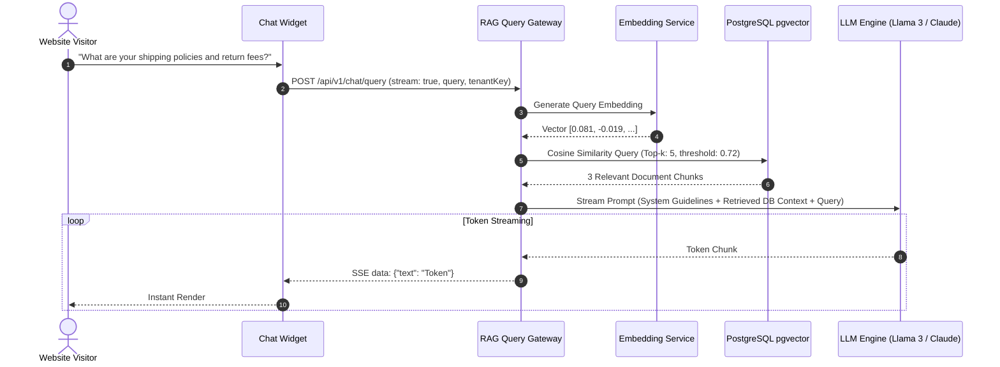

# Module 04: Query & RAG Retrieval Module

## 1. Module Overview & Purpose

The **Query & RAG Retrieval Module** acts as the conversational intelligence brain. When a website visitor asks a question in the chat widget, this module:
1. Converts the question into a dense query vector.
2. Conducts a high-speed cosine similarity search in `pgvector` scoped to that tenant.
3. Assembles a grounded, hallucination-resistant prompt incorporating the top retrieved database chunks.
4. Streams the final synthesized answer back to the widget using Server-Sent Events (SSE).

---

## 2. Query Retrieval Lifecycle



---

## 3. Vector Similarity Search Query

Vector search executes directly inside PostgreSQL using the `<=>` cosine distance operator:

```sql
SELECT 
  id,
  source_table,
  source_id,
  content,
  metadata,
  1 - (embedding <=> $1::vector) AS similarity_score
FROM document_vectors
WHERE tenant_id = $2
  AND 1 - (embedding <=> $1::vector) >= $3 -- Minimum similarity threshold (e.g. 0.70)
ORDER BY embedding <=> $1::vector ASC
LIMIT $4; -- Top-k (e.g. 5)
```

### Retrieval Optimizations:
- **Cosine Distance vs L2:** Cosine distance handles variations in text length far better than raw Euclidean distance.
- **Threshold Cutoff:** If no database chunks achieve a similarity score >= 0.70, the system triggers the fallback policy rather than feeding irrelevant context to the LLM.

---

## 4. Prompt Engineering & Anti-Hallucination Guardrails

The retrieved chunks are injected into a strict system prompt designed to prevent the LLM from fabricating information not found in the database:

```markdown
You are a verified AI assistant representing the business.
Your sole job is to answer user inquiries accurately using ONLY the verified database records provided below.

==================================================
VERIFIED DATABASE CONTEXT:
{{RETRIEVED_CHUNKS}}
==================================================

CRITICAL RULES:
1. Answer using ONLY information explicitly stated in the context above.
2. If the context does not contain the answer, say:
   "I apologize, but our system does not currently have information regarding that. Please contact support."
3. Never mention internal database IDs, technical table names, or system parameters.
4. Be concise, polite, and directly address the user's inquiry.
```

---

## 5. Streaming API Contract (SSE)

### Request:
```http
POST /api/v1/chat/message
Content-Type: application/json
X-Tenant-Key: tnt_live_8a92bc

{
  "conversationId": "conv_9921b72a",
  "message": "Do you have the ergonomic chair in stock?"
}
```

### Response (Server-Sent Events):
```http
HTTP/1.1 200 OK
Content-Type: text/event-stream
Cache-Control: no-cache
Connection: keep-alive

data: {"event": "sources", "count": 2, "tables": ["products"]}

data: {"event": "token", "delta": "Yes"}

data: {"event": "token", "delta": ", the"}

data: {"event": "token", "delta": " Ergonomic"}

data: {"event": "token", "delta": " Chair is currently in stock."}

data: {"event": "done", "conversationId": "conv_9921b72a"}
```
