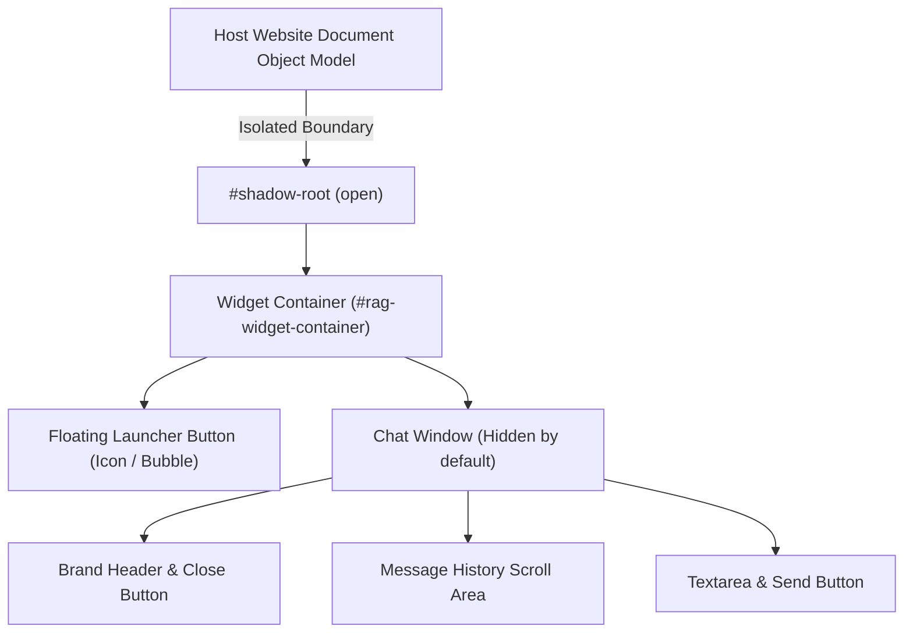

# Module 05: Embeddable Chat Widget Module

## 1. Module Overview & Purpose

The **Embeddable Chat Widget Module** is the customer-facing frontend interface. It is distributed as a lightweight, zero-dependency JavaScript bundle (`widget.js`) that any third-party website can install with a single `<script>` tag.

### Core Objectives:
- Zero CSS collision with host website stylesheets (via **Shadow DOM**).
- Zero third-party runtime dependencies (< 25KB minified/gzipped).
- Real-time token streaming with instant typing feedback.
- Customizable branding (colors, logos, greeting messages).

---

## 2. Installation & Integration Contract

A website embeds the widget by pasting this snippet right before the closing `</body>` tag:

```html
<!-- DB-Native RAG Chatbot Widget -->
<script 
  src="https://api.yourdomain.com/widget.js" 
  data-tenant-key="tnt_live_8a92bc"
  data-primary-color="#2563eb"
  data-position="bottom-right"
  data-greeting="Hi! How can I help you today?"
  defer>
</script>
```

---

## 3. UI Component Architecture (Shadow DOM)



### Why Shadow DOM is Mandatory:
- Prevents the host site's CSS (e.g. Bootstrap, Tailwind, legacy global styles) from breaking the widget's layout.
- Prevents the widget's internal styles from leaking out and altering the host site's buttons or typography.

---

## 4. Client Lifecycle & Streaming Protocol

1. **Initialization:**
   - Reads `data-tenant-key` from its own `<script>` element.
   - Restores or generates a `conversationId` stored in `sessionStorage` (so conversation context survives page navigation).
   - Injects the floating bubble into the DOM.
2. **User Interaction:**
   - On opening the bubble, presents the configured `greeting` message.
   - User types an inquiry and presses Enter.
3. **SSE Stream Processing:**
   - Dispatches a `fetch()` request with `ReadableStream` decoding.
   - Accumulates token deltas and updates the active message bubble DOM with zero UI jank.
   - Automatically scrolls the chat window smoothly to the bottom.

---

## 5. Security & Cross-Origin Protections

| Security Vector | Defense Mechanism |
| :--- | :--- |
| **Origin Whitelisting** | Backend verifies `Origin` / `Referer` headers against allowed domains registered in the tenant's admin dashboard. |
| **XSS Sanitization** | All incoming markdown tokens are sanitized via DOMPurify before insertion into the DOM to prevent script execution. |
| **Rate Limiting** | Client IP and session keys are rate-limited via token bucket (e.g., max 20 queries/minute per session). |
| **Tenant Key Scoping** | The public `data-tenant-key` only possesses query permissions for the RAG endpoint; it has zero access to admin or ingest APIs. |
